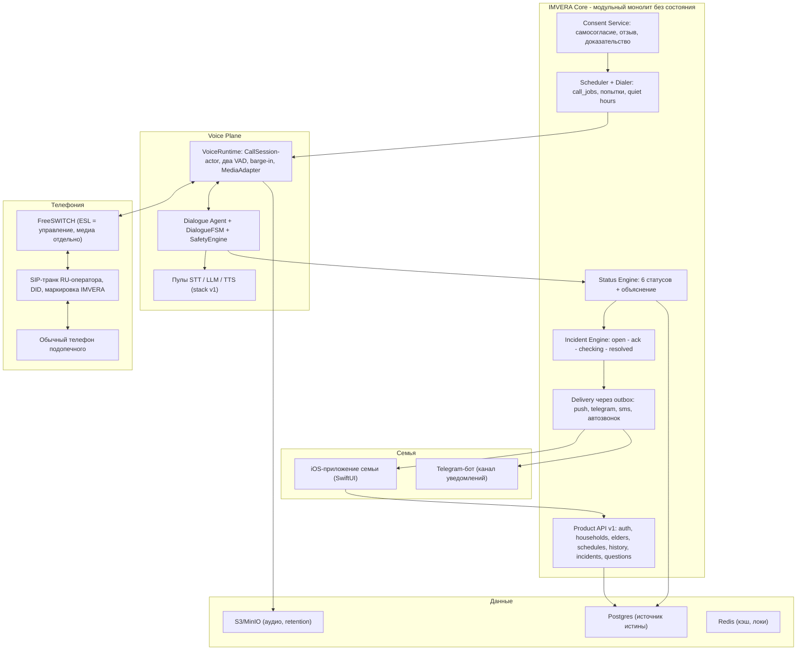
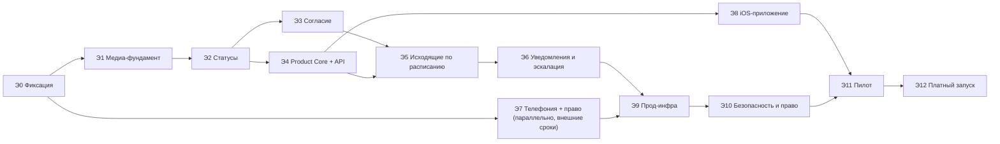

# IMVERA / MossVoice — ROADMAP (канон)

> Утверждено владельцем 2026-09-02. Это **единый маршрут** проекта до
> пилота 20–50 семей и ограниченного платного запуска (как на
> [imvera.ru](https://imvera.ru/)). Предыдущий «Единый маршрут» из
> `AGENTS.md` (шаги 1–9 голоса) поглощён этапами Э0–Э1 здесь.
>
> Агентам: читай этот файл + короткий `AGENTS.md` перед задачей.
> Хроника инцидентов и дневных фиксов — `docs/CHRONICLE.md`.
> Архитектурные решения v1 — `docs/ARCHITECTURE_v1.md`.
> Stack v1 — `docs/STACK_v1.md`.

**Статус этапов (обновлять при закрытии гейта):**

| Этап | Статус |
|------|--------|
| Э0 Фиксация базы | code done — P4 live Zoiper call = owner gate; stack ADR + migrations 003–006 landed |
| Э1 Медиа-фундамент | code done (PreRoll/GenerationGuard/StreamingPcm/harness) — live barge-in 20/20 + 4400 cutover gated on P4 |
| Э2 Статусы | code done — 6 family statuses + TECHNICAL override + DTMF HTTP `/calls/{id}/dtmf`; dialog_quality corpus extend open |
| Э3 Согласие | code done — grant persists to PG; auto consent-call when no active consent; silence→DECLINED |
| Э4 Product Core + API | code done — FastAPI :9480, OTP+JWT, households/elders/schedules/contacts/tokens/invite/call-now/tg-bind; compose `product` |
| Э5 Исходящие по расписанию | code done — lease queue + worker + NO_CONTACT→call_results; dry-run default in compose |
| Э6 Уведомления | code done — DB contacts → IncidentEngine; PushChannel + tg bind; status-broadcast opt-in `MOSS_NOTIFY_ALL_STATUSES` |
| Э7 Телефония + право | decision doc ready — owner/operator actions open (ИП, 41-FZ, trunk) |
| Э8 iOS-приложение | SwiftUI scaffold in `ios/IMVERA/` — TestFlight = owner |
| Э9 Прод-инфра | `deploy/` compose.prod + Caddy + backup + prometheus — restore drill / load-test = owner |
| Э10 Безопасность и право | checklist in `docs/legal/` — lawyer boxes open |
| Э11 Пилот | playbook ready — needs live families |
| Э12 Платный запуск | checklist ready — blocked on E11 exit gate |

---

# IMVERA: полная карта от текущего состояния до платного запуска

## 0. На чём основан план

- Продукт: разобраны тексты imvera.ru (главная, `/investor`, `/support`, `/legal/*`, JS-бандл). Заявлено: 6 статусов `GREEN / YELLOW / RED / NO CONTACT / TECHNICAL / DECLINED`; поток «родственник настраивает профиль, расписание и цель → IMVERA звонит → близкий просто отвечает на обычный телефон → семья получает статус»; согласие подтверждает сам пожилой (семья не может за него; молчание ≠ согласие); эскалация Telegram → push → SMS → автозвонок, кнопка «Я проверю», отслеживание кто отреагировал; приложение семьи с вкладками История / Тревоги / Семья / Расписание; roadmap сайта: Архитектура → Согласие → Диалоги → Статусы → Тревоги → Уведомления → Телефония → Пилот 20–50 семей → Ограниченный платный запуск; «не медсервис, не служба спасения»; риски сайта: зависимость от telecom, ошибки распознавания (DTMF-fallback, объяснимые правила, версионирование сценариев), сбой уведомлений, согласие/ПДн, unit-экономика.
- Код: полный обход репозитория (~29 тыс. строк Python; 335 тестов `telephony` + 42 `voice_runtime`), живые сервисы проверены (`/health`, `/ready` всех компонентов OK на момент проверки).
- Документы: `ENGINEERING_PLAN.md` (§0–§16), `FIXES_PLAN.md` (P0–P11), `read.md` (гейты G0–G11, 18 архитектурных решений), `AGENTS_PLAN_20260831.md` (D1–D7, S1–S7, мост VPS+WireGuard+DID), `HYPOTHESES.md`, `docs/*`.
- Решения владельца из этого чата: приложение семьи — натив iOS сразу (Android позже); транспорт телефонии — не решён, закладывается как решение с критериями и гейтом.
- Допущения (помечены явно): строит один человек с агентами; сроки даю в объёме работы, не календарём; юридические пункты — знания модели + открытые источники, обязательна проверка юристом.
- Проверено поиском (актуально на 2026): 41-ФЗ — с 01.09.2025 маркировка исходящих бизнес-звонков обязательна для ИП/юрлиц; массовые автоматические вызовы требуют отдельного договора с оператором и предварительного согласия абонента с хранением доказательства; штрафы для ИП/малого бизнеса 150–500 тыс. руб. Источники: [secrets.tbank.ru](https://secrets.tbank.ru/blogi-kompanij/chto-izmenilos-posle-41-fz/), [v2b.ru](https://www.v2b.ru/2026/01/27/chto-nuzhno-znat-o-massovyh-vyzovah-markirovke-zvonkov-i/), [exolve.ru](https://exolve.ru/blog/mav-markirovka-i-etiketka-chto-eto-i-kak-rabotaet/).

## 1. Где мы сейчас (реальность кода на 2026-09-02)

Сделано и работает:
- Диалоговое ядро: [telephony/core/dialogue.py](telephony/core/dialogue.py) (Agent + DialogueFSM: 11 состояний, 18 событий, повестка 5 тем + вопросы родных), [telephony/core/fsm.py](telephony/core/fsm.py), [telephony/core/safety_engine.py](telephony/core/safety_engine.py) (детерминированные вердикты, латч RED), [telephony/core/orchestrator.py](telephony/core/orchestrator.py) (стриминг по предложениям, гейты STT, echo-guard, latency trace), `stt_gates.py` / `vocab.py`.
- HTTP API :9400 [telephony/api/http.py](telephony/api/http.py): звонки/ходы/stream-cancel, инциденты (ack/resolve/false-alarm), webhook провайдера с HMAC, вопросы родных по `X-Moss-Key`, исходящий вызов через ESL (`/call`, `/call/phone`).
- Данные: PG-схема (`call_sessions`, `dialogue_turns`, `call_results`, `incidents`, `incident_actions`, `outbox_messages`, `provider_events`, `consents`, `person_memory`, `audit_log`, `elders`, `family_accounts`, `account_access`, `family_questions`), Redis с DEGRADED-семантикой, MinIO; воркеры outbox (инцидент из RED, эскалация по таймерам), retention (TTL-purge с подтверждением удаления в S3), migrate.
- Уведомления: Telegram реально; SMS и автозвонок — generic HTTP к безымянному провайдеру; контакты семьи берутся из ENV (`MOSS_FAMILY_CHAT_ID/PHONE`), не из БД.
- Голосовой контур: FreeSWITCH на Mac (прод 4400 → Lua `record → HTTP → playback`; целевой VoiceRuntime через ESL/park откачен до проверки живым звонком), Silero TTS :9600, llama.cpp Qwen3-4B :9500, хост-сервисы MLX: Qwen3-ASR :9705, Nemotron :9710, Qwen3-TTS :9711, Piper :9712.
- Telegram WebApp — голосовой звонок Вере из браузера (прототип; это не дашборд семьи).
- CI: secret-scan, build, test, test-live.

Нет совсем, хотя обещано сайтом:
- Исходящие звонки по расписанию (планировщик, политика попыток, статус NO CONTACT).
- Поток согласия подопечного — только таблица `consents` без логики. Сайт помечает «Согласие: done»; в коде этого нет (возможно, имеется в виду юридический текст согласия — точно не знаю).
- Статусы NO CONTACT / TECHNICAL / DECLINED — код знает только `ok / attention / alert`.
- Аккаунты семьи с контактами, порядком эскалации, расписанием и профилем подопечного (есть только API-ключи для вопросов).
- Push (APNs), SMS-провайдер, автозвонок семье, кнопка «Я проверю» из приложения.
- iOS-приложение и Product API под него.
- Телефония на реальные номера: SIP-транк, DID, публичный сервер, маркировка по 41-ФЗ.
- ИП/ООО, уведомление РКН, оферта, платежи.
- Прод-инфраструктура на Linux, мониторинг и алерты, бэкапы и восстановление.

Техдолг, который влияет на маршрут:
- В рабочем дереве ~1000 строк незакоммиченных изменений (hardening API: bearer-токен, rate-limit, webhook fail-closed, spool fsync/0700, promise-guard, правки FSM); `AGENTS.md` на диске новее, чем снапшот в начале чата — параллельно работает другая сессия. Сначала ревью и коммит.
- Стек моделей менялся несколько раз за неделю (LLM облако ↔ llama.cpp; STT whisper ↔ Qwen3-ASR ↔ Nemotron; TTS Silero ↔ Qwen3-TTS). Нужна заморозка «stack v1» по бенчмарку на реальных записях.
- Хост-сервисы STT/TTS завязаны на Apple MLX — на Linux-сервер как есть не переносятся.
- Barge-in не проверен живым звонком; два файла миграций с префиксом `002_`; Lua и VoiceRuntime сосуществуют; `/health` показывает `calls_active=3` без известных живых звонков — проверить утечку сессий или loopback-шум.

## 2. Целевая система

### Функциональная карта (что система должна уметь)

Подопечный (только телефон):
- Принимает звонок в назначенное окно; первый звонок — согласие голосом или DTMF; может отказаться или отозвать согласие в любом звонке.
- Разговор по мягкой повестке (самочувствие, настроение, сон, планы, передать родным, вопросы от семьи); переспрос при плохой слышимости; DTMF-fallback «1 — всё хорошо, 2 — нужна помощь».
- Вера никогда не обещает вызвать/позвонить; при угрозе жизни говорит про 112.

Семья (iOS):
- Регистрация (телефон + OTP или Sign in with Apple), создание семьи, приглашение членов и роли.
- Профиль подопечного (имя, обращение, часовой пояс, особенности слуха/речи, цель звонков), расписание (дни, окна, частота, quiet hours, пауза), «позвонить сейчас» с лимитом.
- История: статус каждого звонка с объяснением и длительностью; фильтры; аудио и транскрипт — только при явном согласии подопечного и по роли.
- Тревоги: список инцидентов, таймлайн эскалации, кнопка «Я проверю», кто отреагировал, закрытие / ложная тревога.
- Вопросы родным для следующего звонка (уже есть API).
- Push, настройки уведомлений, удаление аккаунта и экспорт данных.

Core:
- Планирование звонков и попытки → NO CONTACT; статус TECHNICAL при любом сбое; DECLINED из согласия; версионирование сценариев и правил в каждом результате.
- Инциденты и эскалация по цепочке каналов с таймерами; outbox без потерь и дублей.
- Аудит всех действий, retention и удаление по запросу, роли и авторизация на каждом запросе.

Эксплуатация:
- Метрики по стадиям звонка, доля TECHNICAL, лаг outbox, ошибки провайдеров; алерты; бэкапы и восстановление; kill-switch исходящих; runbook.

## 3. Этапы

### Э0 — Фиксация базы (оценка: ~1 неделя)
- Ревью и коммит незакоммиченного hardening; `make test-fast` и `voice_runtime` тесты зелёные; переименовать дубли `002_*` миграций (следующий номер) с сохранением совместимости `schema_migrations`.
- Заморозить архитектуру v1.0: 18 решений из `read.md` (FreeSWITCH остаётся, Lua удаляется, один VoiceRuntime, ESL = только управление, PCM16 16k/20мс, `generation_id` как граница, Agent не знает про SIP/RTP, persistence вне latency-пути и т.д.) → `docs/ARCHITECTURE_v1.md`.
- Stack v1 по бенчмарку на реальных записях (локальные `/tmp/mossvoice`, MinIO): STT (Qwen3-ASR vs Nemotron vs whisper-base), TTS (Silero vs Qwen3-TTS vs Piper), LLM (Qwen3-4B локально vs облако). Критерии: WER на телефонной речи, p50/p95 латентность, RTF, лицензия для коммерческого использования (Silero — AGPL/CC BY-NC, нужна проверка), переносимость на Linux. Результат — один зафиксированный набор переменных; остальное остаётся аренами.
- P4: живой звонок владельца через Zoiper на VoiceRuntime (4402): факт стерео/tap/эхо, решение «стерео vs echo-guard».
- `AGENTS.md`: «Текущее состояние» переносится в хронику, маршрут заменяется ссылкой на этот документ.
- Гейт: чистый `git status`, зелёные тесты, задокументированный stack v1, результат P4 записан.

### Э1 — Медиа-фундамент (гейты G1–G4; оценка: 2–3 недели)
- Главный технический milestone из `read.md`: без LLM — Вера играет фразу, абонент перебивает «раз два три», выход останавливается ≤300 мс, записанный PCM начинается с «раз». 20 из 20.
- Production `MediaAdapter` в [voice_runtime/media_adapter.py](voice_runtime/media_adapter.py): непрерывный PCM16 16k/20мс из FreeSWITCH (кандидаты: `mod_audio_stream`/`mod_audio_fork` по WebSocket; либо `uuid_record` с подтверждённым разделением каналов) вместо tail-чтения WAV; pre-roll 300–500 мс; два VAD (onset для barge-in, endpoint для конца хода); жёсткий flush по `generation_id`; admission до `answer`.
- Стриминговый STT по хопам без умножения декода; первый звук ≤1.5 с.
- Cutover 4400 → VoiceRuntime через [scripts/install_freeswitch.sh](scripts/install_freeswitch.sh); удалить `moss_agent.lua` после подтверждённого cutover; 4402 — только тест.
- Гейт: 20 × 5-минутных звонков подряд без сбоя; barge-in 20/20; latency trace p50 <1.5 с до первого звука; тесты зелёные.

### Э2 — Статусы и объяснимость (оценка: 1–2 недели)
- Единый enum статуса результата звонка `GREEN / YELLOW / RED / NO_CONTACT / TECHNICAL / DECLINED` (миграция `call_results`; маппинг из SafetyEngine: `ok → GREEN`, `attention → YELLOW`, `alert → RED`); TECHNICAL — на любой сбой STT/LLM/TTS/медиа (инвариант «ошибка никогда не выглядит как GREEN или NO_CONTACT» уже заявлен в §0 ENGINEERING_PLAN); NO_CONTACT из политики попыток (Э5); DECLINED из согласия (Э3).
- Объяснимый статус: `reasons[]` (какие фразы/правила/уверенность дали статус) и `summary_for_family` (2–3 предложения детерминированно из фактов и заметок); сырой транскрипт в уведомления не идёт.
- Версионирование: `scenario_version` и `safety_rules_version` в каждом `call_results` (риск с сайта «версионирование сценариев»).
- DTMF-fallback (риск с сайта): после 2+ пустых или низкоуверенных ходов — «если всё хорошо, нажмите 1; если нужна помощь — 2»; DTMF-события ESL → событие FSM.
- Диалог: закрыть открытые пункты (трёхуровневое подтверждение по уверенности STT, follow-up слоты тем), харнесс [voice-lab/dialog_quality.py](voice-lab/dialog_quality.py) расширить сценариями на каждый из 6 статусов.
- Гейт: регресс-корпус — 0 ложных GREEN; каждый статус воспроизводится офлайн-тестом; харнесс `--strict` зелёный.

### Э3 — Согласие подопечного (оценка: ~1 неделя)
- Первый звонок = звонок согласия: скрипт «по просьбе <имя родственника> буду звонить регулярно… согласны?» → «да» / DTMF 1 → запись в `consents` (person_id, scope: звонки + запись, method: voice | dtmf, доказательство: ключ аудио + hash, время, версия скрипта). «Нет» или молчание → DECLINED, расписание выключается, семья видит статус.
- Отзыв в любом звонке («не звоните больше») → revoke → DECLINED; семья не может дать согласие вместо подопечного (принцип сайта); уведомление о записи разговора в начале.
- Хранение и экспорт доказательства согласия — для оператора связи (41-ФЗ) и для 152-ФЗ.
- Гейт: инвариант «без действующего согласия планировщик не создаёт звонков» покрыт тестом; FSM согласия протестирована.

### Э4 — Product Core и Product API (оценка: 2–3 недели)
- Модель данных: `users` (семья), `households`, расширение `elders` (профиль, часовой пояс, особенности), `contacts` (порядок эскалации, каналы), `schedules` (дни, окна, частота, quiet hours, политика попыток), `device_tokens` (APNs), `call_jobs`; роли владелец / член семьи / наблюдатель; `audit_log` на каждое действие; `tenant_id`/`household_id` во всех durable-контрактах (§16 шаг 2).
- Product API v1 (`/api/v1/...`, OpenAPI + JSON Schema валидация, версионирование): auth (OTP по телефону и/или Sign in with Apple), households/elders CRUD, schedules, история звонков (статус + объяснение + длительность), инциденты (список, «Я проверю» = ack, resolve, false-alarm), вопросы родных (есть), настройки уведомлений, статус согласия, удаление аккаунта и экспорт.
- Безопасность: JWT RS256 с коротким TTL и ротацией refresh, авторизация на каждом запросе по household (защита от IDOR), rate limits per user/IP (token-bucket уже есть), PII-минимизация, шифрование аудио at rest, логи без транскриптов; интеграционная граница с существующим `:9400` — Product API отдельным процессом на том же ядре (поправка №13 `read.md`).
- Гейт: контракт-тесты API; e2e «создать семью → добавить подопечного → расписание → симулированный звонок → статус в истории → инцидент → ack».

### Э5 — Исходящие звонки по расписанию (оценка: 1–2 недели)
- Планировщик на Postgres (`call_jobs`: `due_at`, `attempt_no`, состояние; lease `FOR UPDATE SKIP LOCKED` как в outbox) — без нового брокера; политика попыток (например 3 × 15–20 минут внутри окна): занято / нет ответа / автоответчик → следующая попытка; исчерпано → NO_CONTACT + уведомление семье «состояние неизвестно».
- Dialer: `originate` через ESL из VoiceRuntime (единый владелец звонка; `call_attempts` из событий CHANNEL_* и CDR → `provider_events`), caller-ID с маркировкой, admission по одновременным звонкам, запрет вне quiet hours и без согласия.
- «Позвонить сейчас» из приложения с лимитом; kill-switch исходящих.
- Гейт: 100 синтетических job на loopback — ни одного двойного звонка, корректные NO_CONTACT, идемпотентность при рестарте воркера.

### Э6 — Уведомления и эскалация end-to-end (оценка: ~2 недели)
- Контакты из БД вместо ENV; цепочка per household: push APNs (новый канал) → Telegram (привязка чата по deep-link коду) → SMS (выбрать RU-провайдера; адаптер `SmsChannel` generic HTTP уже есть) → автозвонок семье через собственный FreeSWITCH (TTS озвучивает инцидент, DTMF «1 — я проверю») вместо HTTP-провайдера.
- «Я проверю» из приложения или DTMF → `incident.ack` с actor; фиксация «кто отреагировал»; таймеры эскалации (есть); напоминание при просрочке resolve.
- Статус после каждого звонка (push/Telegram), не только тревоги; дневной дайджест по настройке.
- Гейт: drill-тесты `test_incidents` расширены на push и автозвонок; ни одного двойного уведомления; падение канала → следующий; рестарт между enqueue и доставкой не теряет сообщение.

### Э7 — Телефония на реальные номера и правовые предпосылки (инженерия 1–2 недели; внешние сроки — недели)
- Решение по транспорту (гейт с критериями): A) свой FreeSWITCH на арендованном сервере + SIP-транк RU-оператора; B) CPaaS с API звонков и медиа-стримом. Критерии: цена минуты и номера, поддержка маркировки и договора на массовые вызовы, работа с ИП, G.711 без транскодинга, SIP TLS/SRTP, срок подключения, документация под FreeSWITCH. Для пилота хватает ~100 звонков/день при пике 3–5 одновременных.
- Промежуточный шаг из `AGENTS_PLAN_20260831.md`: VPS + WireGuard, Mac как compute; звонок с реального телефона через туннель; затем DID.
- Обязательно по праву (подтверждено поиском, 41-ФЗ): регулярные автозвонки = массовые автоматические вызовы → ИП или ООО, договор на маркировку (метка «IMVERA», до 32 символов), отдельный договор на массовые вызовы, доказуемое согласие абонента (даёт Э3).
- Хардненинг перед публичным SIP (чек-лист из `AGENTS_PLAN`): ACL по IP оператора, отдельный sofia-профиль, fail2ban, запрет международных исходящих, лимиты и kill-switch, SRTP/TLS где поддерживается, маршрут только конкретного DID.
- Гейт: 3 звонка подряд с реального мобильного и стационарного номера прошли весь контур; внешний скан (svmap) не находит открытых уязвимостей; чужие REGISTER блокируются и логируются.

### Э8 — iOS-приложение семьи (оценка: 4–6 недель; решение владельца — натив сразу)
- SwiftUI, iOS 17+; вход; онбординг: добавить подопечного, объяснить согласие («подтвердит сам при первом звонке»), расписание, цель звонка, контакты и порядок эскалации.
- Вкладки как на сайте: История, Тревоги («Я проверю», таймлайн, кто отреагировал), Семья (подопечные, контакты, роли, приглашения), Расписание (окна, quiet hours, пауза, «позвонить сейчас»).
- Push через APNs (критические оповещения — отдельное разрешение Apple, обоснование в заявке), вопросы родным, настройки, удаление аккаунта, экспорт.
- Доступность: крупный шрифт, контраст, VoiceOver; тексты без медицинских обещаний (дисклеймер «не медсервис» — ограничение App Store Review для health-claims).
- Гейт: TestFlight с внутренними тестерами; e2e с реальным звонком; краш-фри ≥99%.

### Э9 — Прод-инфраструктура и эксплуатация (оценка: ~2 недели)
- Решение по compute: (a) Linux-сервер CPU 8–16 ядер (Silero и faster-whisper переносимы; Qwen3-ASR/Nemotron на CPU — замерить), (b) сервер с GPU 24 ГБ (весь стек + запас), (c) Mac как compute за WireGuard (быстро, но один узел дома, без HA). Критерий: p95 первого звука <1.5 с при 5 одновременных звонках и стоимость в месяц.
- `deploy/`: compose.prod + systemd, TLS для Product API (Caddy/Traefik), секреты через sops/age или Vault, pinned образы, миграции в шаге деплоя, drain активных звонков при выкладке (поправка №17 `read.md`).
- Наблюдаемость: Prometheus (звонки, латентность по стадиям, лаг outbox, ошибки провайдеров, доля TECHNICAL), Grafana, алерты (RED без доставки, рост очереди, TECHNICAL выше порога, диск/CPU), логи с `call_id` и без транскриптов.
- Бэкапы: nightly `pg_dump` + WAL, versioning MinIO, restore drill до пилота; runbook инцидентов; on-call — владелец с эскалацией по телефону.
- Гейт: restore drill пройден; нагрузочный тест 5 одновременных синтетических звонков 1 час без деградации; алерты срабатывают на drill.

### Э10 — Безопасность и право (инженерия 1–2 недели; юрист параллельно)
- Threat model и пентест-чеклист: toll fraud, auth API, IDOR по household, PII в логах, SSRF через URL провайдеров (`MOSS_ALLOW_INSECURE_PROVIDER_HTTP`), параметризованные запросы, rate limits, секреты, зависимости (SCA, pinned).
- 152-ФЗ (знания модели — проверить юристом): уведомление РКН об обработке ПДн, привязка политики и согласия с сайта к реальной обработке (аудио, транскрипты, телефоны), локализация данных в РФ, публичные сроки retention (worker есть), удаление по запросу (каскад PG+S3 есть), письменная фиксация «голос не используется для идентификации» (не биометрия).
- Не-медицинский статус: формулировки в приложении и в речи Веры; при угрозе жизни — совет вызвать 112.
- Для платного запуска: ИП с ОКВЭД, оферта, тарифы, рекуррентные платежи (ЮKassa / CloudPayments / Т-Банк — решение), чеки 54-ФЗ; правила Apple для цифровых подписок (IAP или разрешённый веб-вариант — проверить актуальные правила на момент релиза).
- Гейт: чеклист закрыт, юрист подтвердил документы, secret-scan зелёный, пентест без критичных находок.

### Э11 — Пилот 20–50 семей (прогон 6–8 недель)
- Набор семей (Telegram, сайт), онбординг через TestFlight, согласие подопечных, расписания; поддержка (Telegram/почта), еженедельный разбор звонков, kill-switch, план реакции на инциденты.
- Метрики (с сайта и `/investor`): качество контакта и статусов (распределение 6 статусов, ложные RED по разбору, согласие семьи со статусом), надёжность эскалации (время до ack, доля доставленных), готовность платить (опрос + тестовая цена), операционные затраты (минуты, сервер, SMS, стоимость успешного контакта), использование и отзывы (NPS, удержание).
- Гейт выхода: ≥80% звонков завершаются GREEN/YELLOW/RED без TECHNICAL; ложные RED ниже согласованного порога; известна стоимость успешного контакта; есть семьи, готовые платить.

### Э12 — Ограниченный платный запуск (оценка: 2–3 недели + рост)
- Цена по данным пилота; биллинг и подписка; SLA поддержки; публикация в App Store; Android (Kotlin) или кросс-платформа — решение по данным пилота.
- Масштабирование по §16 ENGINEERING_PLAN: первая cell, пулы STT/TTS/LLM с admission, вторая нода FreeSWITCH, load-test сертификация лимита cell.

## 4. Порядок и критический путь

- Критический путь: Э0 → Э1 → Э2 → Э4 → Э5 → Э6 → Э9 → Э11.
- Параллельно с первого дня: Э7 (запросы операторам/CPaaS, ИП, договоры — у них самые длинные внешние сроки) и юрист по Э10.
- Э8 (iOS) стартует после стабилизации контракта Product API в Э4; до этого — макеты и модель данных.
- Заморозки из `AGENTS.md` (новые таблицы, UI, billing) снимаются на Э4, как и предполагал шаг 8 единого маршрута.

## 5. Решения, которые нужны от владельца (с критериями)

- Транспорт телефонии (Э7): свой FreeSWITCH + SIP-транк vs CPaaS — по цене минуты, поддержке маркировки/массовых вызовов для ИП, качеству медиа, сроку.
- Compute для прода (Э9): Linux CPU vs GPU vs Mac за туннелем — по p95 первого звука при 5 одновременных и стоимости.
- Stack v1 моделей (Э0): по бенчмарку на реальных записях, включая лицензии.
- SMS-провайдер (Э6) и платёжный провайдер (Э10/Э12).
- Юрлицо: ИП vs ООО — до подписания договоров с оператором.
- Кто делает iOS: самостоятельно или подрядчик — влияет на длительность Э8.

## 6. Метрики и гейты сквозные

- Безопасность диалога: 0 ложных GREEN на регресс-корпусе (каждый PR в core).
- Латентность: первый звук p50 <1.5 с, p95 <2.5 с; barge-in ≤300 мс.
- Надёжность: 20 × 5 мин без сбоя; доля TECHNICAL <5% на пилоте; 0 потерянных уведомлений (drill).
- Продукт: время до ack инцидента, распределение статусов, NPS семей, стоимость успешного контакта, готовность платить.
- Право: РКН-уведомление подано, договоры маркировки и массовых вызовов подписаны, доказательства согласия хранятся и экспортируются.

## 7. Риски (честно)

- Технические: MediaAdapter и barge-in ещё не доказаны на живом звонке — это может занять больше 3 недель; хост-сервисы на MLX не переносятся на Linux; качество Qwen3-4B локально может не дотянуть — тогда облако с доп. стоимостью и вопросом ПДн (транскрипты за рубеж — проверить юристом).
- Правовые: без ИП, договоров маркировки/массовых вызовов и согласия оператор заблокирует звонки; штрафы 150–500 тыс. руб.
- Бизнес: готовность платить неизвестна (сайт честно это заявляет); стоимость успешного контакта до пилота — только оценка.
- Операционные: один человек на разработку, эксплуатацию, поддержку и пилот; on-call без резерва.
- Процессные: параллельные сессии агентов в одном рабочем дереве без коммитов — риск потери работы; частые смены стека без бенчмарка.

## 8. Оценка объёма (не календарь)

- Инженерия Э0–Э10: ориентировочно 20–28 недель работы одного человека с агентами; iOS — 4–6 из них.
- Внешние ожидания (оператор связи, ИП, юрист, Apple review): недели, идут параллельно.
- Пилот: 6–8 недель прогона.
- Итого до ограниченного платного запуска: порядка 7–9 месяцев при одном исполнителе. Это оценка, а не обещание.

## 9. Первые две недели после утверждения

- Э0 целиком: коммит hardening, stack v1 по бенчмарку, ADR v1.0, P4 живой звонок, чистка `AGENTS.md`.
- Начать Э1 с milestone «barge-in 20/20 без LLM».
- Отправить запросы 2–3 операторам/CPaaS про маркировку и договор на массовые вызовы для ИП; записаться к юристу по 152-ФЗ/41-ФЗ.
- Этот документ (`ROADMAP.md`) — каноническая карта; `AGENTS.md` ссылается сюда. Хроника состояния — `docs/CHRONICLE.md`.