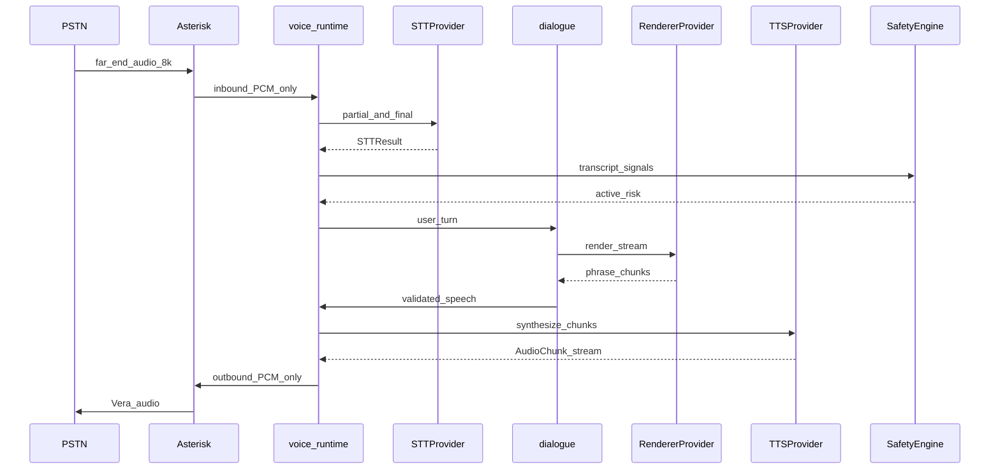

# VoiseUp — System Architecture

> **Version:** Architecture Freeze v1 (see [PLAN.md](PLAN.md) v1.2)  
> **Status:** Phase 1 — specification only, no runtime pipeline code yet.

## Purpose

Real-time voice + telephony layer for [IMVERA](https://imvera.ru/): phone calls to elderly relatives, dialogue with Вера, deterministic call outcomes for families.

## Boundaries

| In voiseup | Outside voiseup (later) |
|------------|-------------------------|
| SIP/PSTN media bridge | Family mobile app |
| CallSession, TurnManager, barge-in | Production Core API (mock in Phase 6) |
| Dialogue FSM, Planner, Renderer, Validator | Real TG/SMS/push delivery |
| Safety signals + SafetyEngine | Final incident lifecycle in prod Core |
| StatusEngine (domain logic) | Billing, auth, households UI |
| Event emission + durable spool contract | |

## Deployable blocks (4)

```text
┌─────────────┐     ┌──────────────────┐     ┌─────────────────┐     ┌──────────────┐
│  telephony  │────▶│  voice-runtime   │────▶│ speech-services │     │ backend-mock │
│  Asterisk   │     │  CallSession     │     │ STT TTS LLM     │     │ (Phase 6)    │
│  ARI app    │◀────│  TurnManager     │◀────│ providers       │     │ events API   │
└─────────────┘     └──────────────────┘     └─────────────────┘     └──────────────┘
```

## Data flow (one turn)



## Ownership (non-negotiable)

```text
Planner       → what to do next
State         → facts, slots, pending question
Renderer      → surface text (LLM assist)
Validator     → may this be spoken
Realtime      → timing, cancel, playback accounting
Transport     → SIP/media only
SafetyRules   → deterministic pattern signals
SafetyEngine  → merge → active_risk, highest_signal_seen
StatusEngine  → 4 internal axes → 6 public statuses
```

## Package layout

```text
packages/
  contracts/     # schemas, provider protocols, events (Phase 1)
  dialogue/      # FSM, Planner, State, Validator (Phase 2)
  safety/        # Rules, SafetyEngine (Phase 2)
  status/        # StatusEngine (Phase 2)
  incident/      # incident state machine (Phase 2)
  voice_runtime/ # CallSession, TurnManager (Phase 4)
  telephony/     # Asterisk adapter (Phase 5)

services/
  stt/           # WhisperSTTProvider (Phase 3)
  tts/           # SileroTTSProvider (Phase 3)
  backend-mock/  # HTTP (Phase 6)

tools/voice_lab/ # benchmarks (Phase 3)
```

## Correlation IDs

Every artifact in a call shares:

```text
call_id → turn_id → generation_id → phrase_id → event_id → sequence_no
```

## Hot path rules

- No synchronous Postgres/S3/Core HTTP between `speech_end` and `tts_first_pcm`.
- Critical events: **durable record before side effect** (see [contracts/events.py](../packages/contracts/events.py)).
- `canonical_assistant_text` per phrase; playback accounting for `heard` vs `generated`.

## Related documents

- [PLAN.md](PLAN.md) — master plan, phases, gates
- [AUDIO_CONTRACT.md](AUDIO_CONTRACT.md) — sample rates, full-duplex
- [DIALOGUE_SPEC.md](DIALOGUE_SPEC.md) — FSM, slots, scenarios
- [adr/](adr/) — architecture decision records
