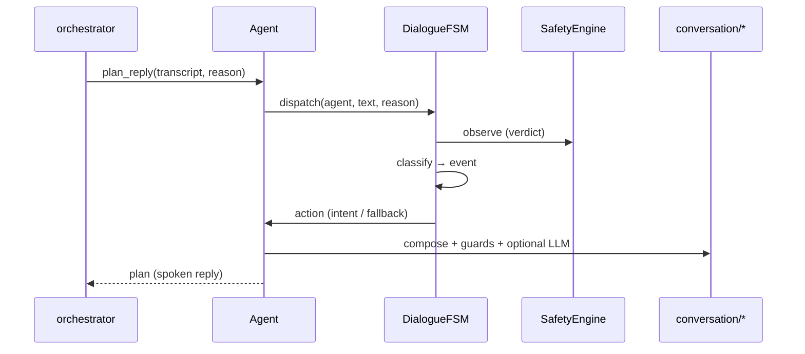

# Dialogue 4.0 — план эволюции (2026-09-03)

> **Статус:** планирование после закрытия Dialogue 3.0 и рефакторинга пакета
> `telephony/core/dialogue/`. Не заменяет DialogueFSM — описывает следующий слой
> понимания хода и политики ответа поверх него.

## 1. Зачем Dialogue 4.0

Dialogue 3.0 закрыл **механические** дефекты: повторы, зеркалирование, DTMF в тишине,
nested FSM bug, rotated pools, dedupe, symptom clearing. Офлайн-гейт
`voice-lab/dialog_quality.py --strict` (**23/23 PASS**) ловит инварианты, но **не**
измеряет «живость» и уместность ответа на длинные реплики пожилого человека.

Оставшиеся классы проблем (подтверждены звонками `70c2e5c25d81`, `d74a7df599fa` и кодом):

| Класс | Симптом | Корень сегодня |
|-------|---------|----------------|
| Поверхностное понимание | Длинный рассказ → шаблонный вопрос по agenda | `SkillState.topics_covered` = индекс agenda, не семантика |
| Side-question без ответа | «Кто ты?» → снова «Как спали?» | FSM resume агрессивнее, чем ответ по сути (pools частично закрыли) |
| Ложная уверенность тестов | 23/23 PASS при «позорном» UX | Харнесс проверяет regex-инварианты, не смысл |
| Тонкий stub | `ConversationEngine` = sanitize + limits | Goal-FSM не мигрирован |
| LLM off по умолчанию | Одинаковые pools на pilot-темах | `MOSS_DIALOGUE_LLM_CHECKIN=0` — осознанный default |

**Цель Dialogue 4.0:** отделить **понимание хода** (что сказал человек и что это значит для
цели звонка) от **политики ответа** (что Вера должна сделать дальше) и от **исполнения**
(pools / guarded LLM / safety). DialogueFSM остаётся исполнителем фаз; новый слой
поставляет структурированный контекст и цели.

---

## 2. Текущая архитектура (после split 2026-09-03)

```
telephony/core/dialogue/
  __init__.py      — публичный API (Agent, DialogueFSM, prompts, classifiers)
  variety.py       — cross-call phrase ring (_RECENT_SPOKEN)
  cleaners.py      — clean_transcript, short_real_answer
  classifiers.py   — closing/refusal/question/meta (события FSM)
  prompts.py       — VERA_SYSTEM_PROMPT, word lists, _clean_llm
  skill_state.py   — компактный snapshot для LLM
  fsm.py           — DialogueFSM (11 states, declarative transitions)
  agent.py         — Agent.plan_reply, agenda, LLM path

telephony/core/conversation/
  compose.py, pools.py, guards.py, goals.py, flags.py, reply.py, engine.py
```

Поток одного хода:



**Инвариант (сохраняем):** safety-вердикт детерминирован в `SafetyEngine`; Agent/FSM
не «отменяют» RED без confirm-gate.

---

## 3. Целевая архитектура Dialogue 4.0

### 3.1. TurnUnderstanding (новый модуль)

**Ответственность:** один раз на ход построить нормализованное понимание реплики без
побочных эффектов.

```python
@dataclass(frozen=True)
class TurnUnderstanding:
    raw_text: str
    clean_text: str
    reason: str | None          # empty | low_conf | echo | ...
    speech_act: SpeechAct     # answer | question | greeting | closing | refusal | narrative | ...
    topic_signals: tuple[str, ...]   # ключи из TOPIC_KEYS / извлечённые факты
    symptom_focus: str | None
    answers_control: bool       # yes/no на последний контрольный вопрос
    confidence_band: str        # high | medium | low (STT + vocab gate)
```

Источники (детерминированные, без LLM в v1):

- `cleaners.clean_transcript`, `short_real_answer`
- `classifiers._is_closing*`, `_is_refusal`, `_is_text_question`, `_is_meta_confusion`
- `compose.extract_symptom_focus`, `TOPIC_KEYS` keyword match
- `SafetyEngine` verdict (read-only)

**Precondition:** `TurnUnderstanding` строится до `DialogueFSM.dispatch`.
**Postcondition:** immutable; guards/actions читают только его, не парсят raw text повторно.

### 3.2. ConversationState (эволюция SkillState)

**Ответственность:** долгоживущее состояние звонка для LLM и политики — не только agenda index.

```python
@dataclass
class ConversationState:
    # agenda (как сейчас)
    topic_index: int
    topics_discussed: list[str]      # семантика, не только idx
    family_questions_pending: list[str]

    # understanding memory
    facts: list[str]
    last_user_act: SpeechAct | None
    last_agent_question: str
    active_symptom: str | None
    symptom_resolved: bool

    # flow flags (extended state — не плодить FSM states)
    narrative_deferred_topic: str | None
    stt_confirm_used: bool
    refusal_armed: bool

    def to_skill_state(self) -> SkillState: ...
    def apply_turn(self, u: TurnUnderstanding, plan_meta: dict) -> None: ...
```

**Ключевое отличие от SkillState:** `topics_discussed` пополняется при **содержательном**
ответе по теме (keyword + min words / symptom / narrative), а не при `agenda_idx += 1`.

### 3.3. Observer (логирование + quality, без влияния на hot path)

**Ответственность:** после каждого хода записать наблюдаемые метрики для регрессии и
живых разборов.

```python
@dataclass
class TurnObservation:
    call_id: str
    turn_no: int
    understanding: TurnUnderstanding
    fsm_state_before: str
    fsm_event: str
    fsm_state_after: str
    reply_source: str          # pool | llm | script | safety
    quality_flags: list[str]   # repeat_question, ignored_side_q, ...
```

Персистенция: опционально JSONL в spool / колонка `dialogue_turns.meta` (уже есть JSON).

**Инвариант:** Observer never mutates Agent; fail-open на ошибке записи (log + continue).

### 3.4. Policy goals (тонкий слой над FSM)

Вместо разрастания `if` в `Agent._a_*`, ввести **декларативные цели** на ход:

```python
@dataclass(frozen=True)
class ResponseGoal:
    kind: str           # acknowledge | ask_topic | clarify | safety_confirm | answer_side | close
    topic: str | None
    must_include: tuple[str, ...]   # жёсткие слоты («симптом», текст family question)
    allow_llm: bool
    fallback_pool: str
```

`DialogueFSM` actions возвращают `ResponseGoal`; `conversation/reply.py` резолвит
spoken text (pools → guarded LLM). Сегодня это частично делают `build_*_intent` —
миграция: intent-строки → typed `ResponseGoal`.

---

## 4. Фазы внедрения

### Фаза 4.0a — TurnUnderstanding + тесты (1 PR)

- [ ] `telephony/core/conversation/understanding.py` + unit tests на сохранённых транскриптах
- [ ] `Agent.plan_reply`: построить `TurnUnderstanding` один раз, передать в FSM context
- [ ] FSM `_classify` читает `understanding` вместо дублирующих regex (постепенно)

**Gate:** `make test-fast` + новые тесты; без изменения прод-поведения (рефактор-only).

### Фаза 4.0b — ConversationState (1 PR)

- [ ] Заменить ad-hoc поля Agent (`_agenda_idx`, `_symptom_resolved`, …) на `ConversationState`
- [ ] `topics_discussed` по keyword rules из `goals.TOPIC_KEYS` + narrative guard
- [ ] `SkillState.update` ← `ConversationState.to_skill_state()`

**Gate:** `dialog_quality --strict` + сценарии «длинный рассказ не закрывает тему» расширены.

### Фаза 4.0c — Observer + offline harness v2 (1 PR)

- [ ] `TurnObservation` в orchestrator после `plan_reply`
- [ ] `voice-lab/dialog_quality.py`: метрики `ignored_side_question`, `topic_reask_after_narrative`
- [ ] Фикстуры из реальных call_id (анонимизированные фрагменты в `voice-lab/fixtures/`)

**Gate:** harness ловит регрессию звонка `70c2e5c25d81` класса багов (replay tests).

### Фаза 4.0d — ResponseGoal + ConversationEngine (2 PR)

- [ ] Typed goals; `ConversationEngine.prepare_plan(goal)` вместо stub
- [ ] Deprecate raw intent strings в пользу `ResponseGoal`
- [ ] Документировать feature flags pilot LLM

**Gate:** owner live Zoiper на 3 сценариях (check-in, side-question, symptom).

### Фаза 4.1 — опционально LLM understanding (отдельный гейт)

Только после стабильного детерминированного слоя:

- LLM slot-filling для `topic_signals` при `confidence_band=medium`
- Строгий JSON schema + timeout 500 ms + fallback на keywords
- **Не** для safety classification

---

## 5. Инварианты продукта (не ломать)

1. Вера **никогда** не обещает вызвать скорую/родных — promise-guard до TTS.
2. Safety RED / UNCERTAIN — только через `SafetyEngine` + confirm-gate.
3. DTMF «нажмите 1/2» **удалён навсегда**; тишина = tapered ladder (ANCHOR → REPEAT → QUIET_HOLD).
4. Telegram как канал звонков **удалён**; уведомления — push/sms/call (Э6).
5. Один вопрос на реплику; женский род; без латиницы в ответе.
6. FSM totality: необработанное событие → warm ack + log, не молчание.

---

## 6. Метрики успеха (Dialogue 4.0 done)

| Метрика | Сейчас | Цель |
|---------|--------|------|
| `dialog_quality --strict` | 23/23 | ≥25 сценариев включая side-q + narrative |
| Повтор вопроса той же темы после narrative | не измеряется | 0 в harness |
| Side-question с прямым ответом | pools частично | 100% scripted answers из `SIDE_QUESTION_ANSWERS` |
| `topics_covered` vs agenda_idx расхождение | частое | 0 на фикстурах |
| Live owner sign-off | pending | 3 звонка без «позорных» моментов |

---

## 7. Связь с ROADMAP

- **Э1 (медиа):** Dialogue 4.0 не блокирует ESL cutover; параллельно.
- **Э2 (статусы):** Observer meta обогащает `dialogue_turns` для семейного дашборда.
- **Э8 (iOS):** `ConversationState` — источник для краткого summary в API.

---

## 8. Команды проверки

```bash
make test-fast
python3 voice-lab/dialog_quality.py --strict
python3 .cursor/skills/anti-stub-enforcement/scripts/verify_no_stubs.py telephony/core/dialogue/
make up telephony   # owner: живой Zoiper
```

---

## 9. Честные ограничения

- Без живого Zoiper после каждого крупного изменения — **не** считаем UX проверенным.
- Hybrid LLM (`MOSS_DIALOGUE_LLM_CHECKIN`) улучшает формулировки, но не заменяет
  TurnUnderstanding; включение флага без 4.0b даёт красивый текст при той же логике тем.
- `verify-stubs` может падать на legacy `orchestrator.py` — отдельный тикет, не блокер split.
