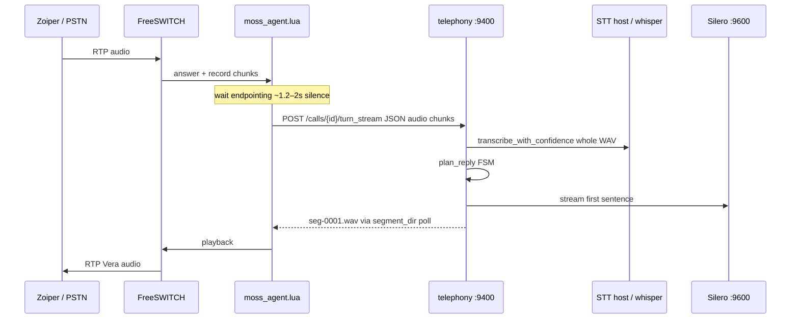

# STT streaming spike — Stage D (Track B1)

> **Date:** 2026-09-03  
> **Scope:** research + minimal glue (`MOSS_STT_STREAMING`, `core/stt_streaming_config.py`).  
> **Not in scope:** full FreeSWITCH `mod_audio_fork` integration (see effort below).

## Goal

Remove the **2 s post-speech wait + batch STT** from the phone path so `speech_end → first_audio` drops from **~4–7 s** (CPU) toward **~2–4 s** per `ENGINEERING_PLAN.md` §15.2 Stage D.

Newo-class **sub-second** latency still requires GPU/realtime voice-to-voice (§14) — this spike targets the **CPU ceiling**, not parity with Newo.

---

## Current architecture (as deployed)



### What exists today

| Component | Location | Role |
|-----------|----------|------|
| **Phone turn transport** | `telephony/moss_agent.lua` | Chunked `record`, JSON `{"audio":[...], "segment_dir":...}`, background `curl` to `/turn_stream`, polls `seg-*.wav` |
| **Batch STT (phone)** | `telephony/core/orchestrator.py` `process_turn_stream` | When `segment_dir` set → **one-shot** `stt.transcribe_with_confidence(wav_path)` — intentional (hop STT ~3× slower e2e) |
| **StreamingSTT (WebApp)** | `telephony/core/events.py` | Non-overlapping PCM hops (`STT_HOP_SECONDS=3`), `feed()` / `finish()`; used when `segment_dir` is **absent** (`/turn_stream` WebApp / tg_server) |
| **STT engines** | `runtime/scripts/tts_common.py`, host `voice_runtime/stt_host.py` (Qwen3-ASR :9705), `nemotron_host.py` (:9710) | Batch `POST /transcribe`; Nemotron also has stub `POST /stream` (single-chunk, not websocket) |
| **Latency trace** | `orchestrator._maybe_latency_trace` | `stt= plan= gen+tts= first_audio=` per turn |
| **Barge-in (partial)** | `voice_runtime/call_session.py`, `POST /calls/{id}/stream-cancel` | Runtime path: `uuid_break` + cancel; **Lua phone path does not call stream-cancel** |
| **MediaAdapter contract** | `voice_runtime/media_adapter.py` | `StreamingPcmAdapter`, `PreRollBuffer`, `GenerationGuard` — production-shaped, **not wired to FS** |
| **Dev media tap** | `voice_runtime/media_tap.py` `LiveWavReader` | Tail-read growing `uuid_record` WAV — **dev-only**; stereo/record_stereo issues documented in AGENTS.md |
| **ESL POC** | removed (`esl_stream.py` deleted per FIXES_PLAN P0) | Was parallel uuid_record bridge; not in tree |

### Phone path vs WebApp path

```text
segment_dir set (Lua)     → batch STT → plan → TTS segments → seg files
segment_dir absent (WebApp) → StreamingSTT hops → plan → TTS wav_b64 frames
```

`MOSS_STT_STREAMING=1` (new) documents intent only: **phone path remains batch** until continuous PCM exists (`core/stt_streaming_config.py`).

---

## What's missing for Stage D

### 1. Continuous caller audio from FreeSWITCH

**Problem:** Lua `record` finishes a turn only after silence; STT starts after HTTP POST. No audio reaches telephony during speech.

**Options (ranked):**

| Option | Pros | Cons | Effort |
|--------|------|------|--------|
| **A. `mod_audio_fork` → WebSocket** | Official FS pattern; stereo/LR split possible; low latency | Module install + dialplan change; WS consumer service | **2–3 w** |
| **B. ESL media bug / tap** | No new FS module; fits `StreamingPcmAdapter` | FS 1.11.1 brew quirks; must not block ESL loop; direction-split hard | **3–4 w** |
| **C. `mod_audio_stream`** | Simple WS PCM | Less control over channel mix; module availability | **2–3 w** |
| **D. Keep uuid_record tail** (`LiveWavReader`) | Code exists | Mixed mono echo; 44-byte empty files; **not production** (AGENTS.md) | **0** (reject) |

**Recommendation:** spike **mod_audio_fork** on a dev extension (`4402`) parallel to Lua 4400; feed `StreamingPcmAdapter.push_frames()` in a small `voice_runtime/fs_audio_ws.py` bridge.

### 2. Streaming STT consumer

**Problem:** `StreamingSTT` decodes **non-overlapping hops** via temp WAV + full `transcribe()` per hop — works for captions, not true realtime.

**Gaps:**

- No websocket ingress feeding `feed()` during live call
- Host STT (`stt_host.py`) is batch-only; Nemotron `/stream` is still one-shot per POST
- Phone orchestrator **disables** hop path when `segment_dir` is set
- No `speech_end` event from VAD shared between runtime and telephony container

**Needed:**

- VAD endpointing in bridge (reuse `voice_runtime/vad.py` onset/complete)
- Either: (a) wire hop `StreamingSTT` during record, or (b) true streaming ASR API (Nemotron streaming, Deepgram, etc.)
- On endpoint: call `plan_reply` with `finish()` transcript — same dialogue code path

**Effort:** **1–2 w** after audio fork (glue + tests); **+1–2 w** if swapping ASR backend.

### 3. Barge-in on Lua path (Track B2)

**Problem:** `moss_agent.lua` uses plain `playback`; comment notes `play_and_detect_speech` unavailable. `stream-cancel` exists in telephony but Lua never POSTs it.

**Exists:**

- `POST /calls/{id}/stream-cancel` → `ctx.cancel_event` + `tts.cancel_stream_by_id`
- `voice_runtime/call_session.py` — full barge-in loop with `uuid_break`
- `tg_server.py` — WebApp barge-in

**Missing:**

- VAD onset on caller channel during Vera playback (Lua or runtime)
- `uuid_break` from Lua or sidecar ESL process
- Generation_id discipline on seg poll (drop stale `seg-*.wav`)

**Effort:** **1–2 w** after direction-split audio (echo-safe VAD).

### 4. Config / ops

- `MOSS_STT_STREAMING=1` — flag landed; phone path unchanged
- Dialplan cutover 4400→runtime (ROADMAP P4/P5) blocked until live Zoiper proof
- Docker telephony cannot reach ESL on host without documented topology

---

## Recommended implementation order

```text
B3 latency baseline (F8 harness)     ← done: voice-lab/latency_baseline.py
B1.1 mod_audio_fork WS spike (4402)  ← 3–5 d: PCM into StreamingPcmAdapter
B1.2 Bridge → StreamingSTT + VAD     ← 5–8 d: endpoint triggers turn_stream
B1.3 Orchestrator: streaming phone   ← 2–3 d: segment_dir + incremental STT flag
B2   Lua/runtime barge-in            ← 5–10 d: uuid_break + stream-cancel
B4   GPU/cloud realtime (optional)     ← product decision
```

**Do not** enable hop STT on `segment_dir` without parallel audio — it would add decode overhead with no latency win.

---

## Minimal spike landed (2026-09-03)

| Artifact | Purpose |
|----------|---------|
| `telephony/core/stt_streaming_config.py` | `MOSS_STT_STREAMING` env reader; documents phone=batch |
| `orchestrator.py` log line | When flag set on phone path, logs Stage D pending (no behaviour change) |
| `docs/STT_STREAMING_SPIKE.md` | This document |

### Env flag

```bash
# WebApp path already uses StreamingSTT when segment_dir is unset.
# Phone path: logs only until audio fork exists.
export MOSS_STT_STREAMING=1
```

---

## Test plan (when implementing B1.1+)

1. `mod_audio_fork` on loopback 4402 → WS client receives 16 kHz mono LEFT
2. Unit: `StreamingPcmAdapter` + `StreamingSTT` fake engine — hops arrive during synthetic PCM feed
3. Integration: endpoint triggers `process_turn_stream` with pre-built WAV from buffer (no Lua)
4. Live Zoiper: compare `LATENCY` `stt=` before/after; target `first_audio` p50 ≤ 4 s CPU
5. Regression: `make test-fast`, `test_streaming_stt.py`, echo-guard unchanged

---

## References

- `ENGINEERING_PLAN.md` §14–15, §15.2
- `docs/LATENCY_BASELINE.md` — F8 harness + gates
- `telephony/core/events.py` — `StreamingSTT`
- `telephony/moss_agent.lua` — `do_turn_stream`
- `voice_runtime/call_session.py` — runtime barge-in model
- `ROADMAP.md` Э1 MediaAdapter
- `docs/STT_ARENA.md` — streaming requirement note
