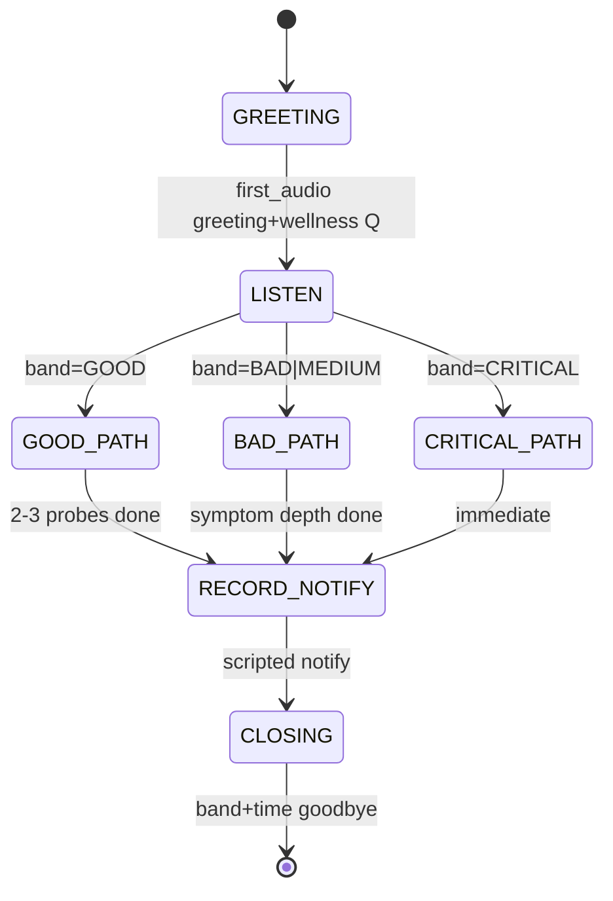

# PRODUCT_FLOW — канонический поток разговора IMVERA

> Статус: **канон продукта** (2026-09-03). Заменяет legacy 6-topic agenda  
> (`доступность → сон → симптомы → помощь → …`).

## Обзор



## 1. GREETING (обязательный первый ход)

- **Пул ≥5** вариативных приветствий (`reply/pools.py` → `GREETING_POOL`)
- Первая фраза = приветствие + «Как вы себя чувствуете?»
- **Scripted only** — без LLM; целевой first audio **<500 ms**
- Открывает **каждый** звонок

## 2. LISTEN → адаптивная ветка

После ответа абонента `AgendaManager.set_wellness_from_text()` → `WellnessBand`:

| Band | Поведение |
|------|-----------|
| `GOOD` | GOOD_PATH: 2–3 простых вопросов о состоянии |
| `BAD` | BAD_PATH: уточняющие вопросы (что болит, как сейчас) |
| `MEDIUM` | BAD_PATH (осторожный follow-up) |
| `CRITICAL` | CRITICAL_PATH: без растягивания → record → fast close |

### GOOD_PATH (2–3 вопроса)

Темы пробы: настроение → сон → планы (`GOOD_PROBE_SUBTOPICS`).  
Пулы: `GOOD_PROBE_POOL` — scripted, без LLM.

### BAD_PATH (глубина симптома)

Уточнения: что беспокоит, сила боли, что чувствует, когда началось.  
Пулы: `BAD_SYMPTOM_PROBE_POOL`.  
После каждого ответа — записать факты; сообщить: «записала, родственники увидят в приложении».

## 3. RECORD_NOTIFY

- Scripted pool `RECORD_NOTIFY_POOL` (≥5)
- **Продуктовое правило:** только «записала / родственники увидят в приложении»
- **Никогда:** «вызову / позвоню / отправлю скорую»

## 4. CLOSING (зависит от band + время суток)

| Band | Прощание |
|------|----------|
| `GOOD` | Хорошего дня/вечера/ночи по времени (утро/день/вечер/ночь) |
| `BAD` | «До свидания», «выздоравливайте», записано для родных |
| `MEDIUM` | «Всё записала, выздоравливайте; если хуже — родные оповещены в приложении» |
| `CRITICAL` | «Всё записала, сообщила родственникам, выздоравливайте» — **fast close** |

## Канонический порядок тем agenda

```text
1. самочувствие      — listen после greeting
2. проба хорошо      — GOOD_PATH (или skip)
3. симптом глубина   — BAD_PATH (или skip)
4. записать родным   — RECORD_NOTIFY
5. прощание          — CLOSING
```

Family questions вставляются **перед** `прощание`.

## Скорость (см. LATENCY.md)

- Greeting / ack / symptom follow-up / closing → **scripted pools**
- LLM разрешён только на narrative/side-question (фаза 3+), не на hot path
- Early first audio: greeting и ack без ожидания LLM

## Инварианты

- I2: без обещаний действий — только записала + приложение
- I3: один вопросительный знак в реплике
- I4: женский род Веры
- Адаптация к клиенту, не жёсткая анкета
